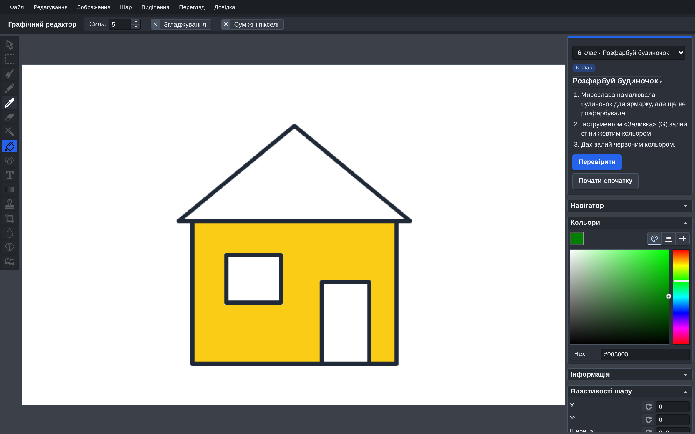

<h1 align="center">edu-graphics</h1>

<p align="center">
  <b>A photo-editor trainer for computer science lessons: layers, brushes, fill, shapes, text and self-checking tasks.</b><br>
  Built on <a href="https://github.com/viliusle/miniPaint">miniPaint</a> (MIT). Made for grade 6 of the Ukrainian school curriculum.
</p>

<p align="center">
  <a href="https://zavada123.github.io/edu-graphics/"><b>Live demo</b></a> ·
  <a href="#lessons">Lessons</a> ·
  <a href="#lesson-manifest">Lesson manifest</a> ·
  <a href="#embedding">Embedding</a> ·
  <a href="#development">Development</a>
</p>

<p align="center">
  
</p>

## Why

Students should learn the tools they will meet in real photo editors: layers, the move tool, selections, the brush, the paint bucket, shapes with an outline and a fill, text layers, export to PNG or JPG. A real editor is hard to check and shows everything at once. `edu-graphics` is a full raster editor with layers where each lesson opens only the tools of its topic and checks the result itself.

The student-facing interface is in Ukrainian. It was built for [EduProstir](https://eduprostir.com).

## Features

- **A full editor**: layers, move, rectangular selection, brush, pencil, eraser, magic eraser, paint bucket, gradient, 20+ shapes (rectangle, ellipse, star, polygon, Bézier curve…), text, clone stamp, crop, blur, sharpen, sponge, adjustments and filters.
- **Familiar names, menus and keys**: the menu is arranged like the menus of common photo editors (Файл, Редагування, Зображення, Шар, Виділення, Фільтр, Перегляд, Довідка) and the usual keys work: V, M, B, I, E, G, U, T, S, C, O with Shift to cycle, `[` and `]` for the brush size, Ctrl+J, Ctrl+Shift+N, Ctrl+E, Ctrl+T, Ctrl+D, Ctrl+Alt+I, Ctrl+Z / Ctrl+Shift+Z and more. Keys are matched by the physical key, so they work with the Ukrainian layout. Help → «Гарячі клавіші» lists the keys of the open lesson.
- **Closed tools stay closed**: a lesson opens some tools; the others are grey («Цей інструмент знадобиться пізніше») or not shown. The same rule guards the tool bar, the menu, the keyboard, the shape picker, drag and drop and paste. The original single-letter keys of miniPaint and internet features (image search, open URL) are off.
- **Self-checking tasks**: conditions on layers (type, fill and outline colour, gradient colours, text, order, position, alignment, spacing), on Bézier curves (length and bend), on pixels (a share of a colour in an area, where a colour spot is), on the canvas size, on the zoom, on the tools used, on the saved file format, and questions with a choice of answers on the task card. Colours are checked by family («any green»), so every correct drawing passes.
- **Full screen** from the task card. In full screen the browser lets the trainer have Ctrl+N, Ctrl+T, Ctrl+W and Ctrl+J (Keyboard Lock in Chrome and Edge); in a window the browser keeps some of them.
- **Ukrainian interface** and a calm graphite look with the EduProstir blue accent. No logos or icons of commercial editors.

## Lessons

| Id | Passport | Task |
|---|---|---|
| `inf6-08-pixels` | inf6-08 | Zoom to 800 %: the photo turns into pixels, the vector star stays smooth |
| `inf6-08-formats` | inf6-08 | Choose formats: SVG for the logo, JPG for the photo, a layered project; a photo saved as SVG is still raster |
| `inf6-09-new-poster` | inf6-09 | New 800 × 600 document, fill it yellow |
| `inf6-09-house-fill` | inf6-09 | Colour a line drawing with the paint bucket |
| `inf6-09-grass-brush` | inf6-09 | Paint grass with the brush |
| `inf6-09-flowerbed` | inf6-09 | An ellipse with a red outline and a green fill |
| `inf6-09-sun-corner` | inf6-09 | Move the sun layer to the top-right corner |
| `inf6-09-export-web` | inf6-09 | Export the poster as PNG or JPG, not as a layered project |
| `inf6-10-star` | inf6-10 | A five-pointed star, yellow fill, orange outline |
| `inf6-10-recolor` | inf6-10 | Recolour the same star (a vector shape keeps its settings) |
| `inf6-10-sunset` | inf6-10 | A sky gradient from warm to blue, moved behind the mountain |
| `inf6-10-rainbow` | inf6-10 | A rainbow arch drawn with the Bézier curve |
| `inf6-11-sun-behind` | inf6-11 | Layer order: the sun goes behind the mountain |
| `inf6-11-flowers-row` | inf6-11 | Align five flowers and space them evenly |
| `inf6-11-title` | inf6-11 | A text with an outline above the flowers |
| `free` | | Free drawing, every tool open |

Open a lesson with `?lesson=<id>`, for example [`?lesson=inf6-09-house-fill`](https://zavada123.github.io/edu-graphics/?lesson=inf6-09-house-fill).

## Lesson manifest

A lesson is an object in [`src/js/edu/lessons.js`](src/js/edu/lessons.js):

```js
{
  id: 'inf6-09-flowerbed',
  passport: 'inf6-09',
  grade: 6,
  title: 'Клумба',
  task: ['Інструментом «Фігури» (U) намалюй еліпс.', '…'],
  manifest: {
    tools: ['select', 'shape'],          // tools that work; the first one is active at the start
    shapes: ['rectangle', 'ellipse'],    // shapes of the «Фігури» tool ('*' for all)
    commands: ['layer/move.*'],          // menu commands that work ('*' at the end is a prefix)
    hidden: ['effects/*'],               // not shown at all; everything else is grey
  },
  start: {                               // the starting picture, bottom layer first
    width: 800, height: 500,
    layers: [
      { kind: 'image', name: 'Галявина', draw: (ctx, w, h) => { /* canvas 2D */ } },
      { kind: 'shape', type: 'ellipse', name: 'Сонце', x: 60, y: 330, w: 110, h: 110, fill: '#facc15', stroke: '#f97316', stroke_size: 4 },
      { kind: 'text', name: 'Назва', x: 280, y: 160, text: 'Ярмарок добра', size: 56, fill: '#b91c1c' },
      { kind: 'fill', name: 'Тло', color: '#ffffff' },
    ],
  },
  questions: [                           // optional: questions with a choice of answers on the task card
    { id: 'logo', text: 'Який формат кращий для логотипа?', options: ['JPG', 'SVG', 'BMP'] },
  ],
  checks: [
    { type: 'layers', match: { type: 'ellipse', stroke: 'red', min_stroke: 4 }, text: 'Контур еліпса червоний', hint: '…' },
    { type: 'answer', question: 'logo', correct: 1, text: 'Для логотипа обрано SVG', hint: '…' },
  ],
}
```

Tool names, shape names and menu targets are listed in [`policy.js`](src/js/edu/policy.js) and [`menu.js`](src/js/edu/menu.js). Undo, zoom and help are always open.

### Checks

| `type` | Passes when |
|---|---|
| `layers` | The number of layers that match `match` is within `min`..`max` (default: at least 1) |
| `recolored` | The start layer `name` is still the same layer (same id) and its fill or outline changed |
| `in_front` | Every `match` layer is above every `behind` layer in the layer stack |
| `above` | Every `match` layer is higher on the canvas than every `over` layer |
| `inside` | A matching layer has its centre in `area` |
| `aligned` | At least `min` matching layers share an edge (`top`, `bottom`, `left`, `right`, `center_x`, `center_y`) |
| `spaced` | Matching layers stand in a row along `axis` with equal gaps or equal steps |
| `canvas` | The canvas is `width` × `height` |
| `pixels` | A share `min_share` of `area` (default: the whole canvas) is painted in the colour `family` |
| `pixels_center` | The pixels of the colour `family` have their centre in `area` |
| `curve` | A finished Bézier curve (matching `match`) is at least `min_span` long and bends at least `min_bend`, `up` or `down` if `bend` is set |
| `zoom` | The student zoomed to `min` or more at some moment of the task (1 is 100 %) |
| `answer` | The option `correct` (from 0) is picked in the question `question` |
| `used` | The student drew with the tool `name` |
| `saved` | The last saved file has one of `formats` (`PNG`, `JPG`, `JSON`…) |

`match` fields: `type` (one or a list), `name`, `fill`, `stroke` (a colour family, a list of families, `none` or `any`), `min_stroke`, `text`, `corners`, `min_size`, `colors` (the two colours of a gradient, in any order, e.g. `[['yellow', 'orange'], 'blue']`). Colour families: `red`, `orange`, `yellow`, `green`, `blue`, `purple`, `pink`, `brown`, `black`, `white`, `gray`.

## Embedding

Put the built site (`index.html`, `dist/`, `images/`) on your server and show it in an iframe:

```html
<iframe src="/graphics/?lesson=inf6-09-flowerbed&embed=1" allow="fullscreen" style="width:100%;height:720px;border:0"></iframe>
```

With `embed=1` the lesson picker is hidden and the trainer posts messages to the page:

```js
window.addEventListener('message', (event) => {
  if (event.data?.source !== 'edu-graphics') return
  // { source, lesson, type: 'ready' }
  // { source, lesson, type: 'checked', solved: boolean, results: [{ ok, text }] }
})
```

The checks run in the browser. Server-side grading of the action log is planned for the integration stage.

## Development

```bash
npm ci
npm test          # unit tests of the trainer logic (Node test runner)
npm run build     # webpack → dist/bundle.js; open index.html through any static server
npm run e2e       # every lesson in a real browser (needs Playwright with Chromium)
```

The trainer code is in [`src/js/edu/`](src/js/edu). Changes to the miniPaint files are small and marked with `EduProstir:` comments: `main.js`, `actions/activate-tool.js`, `core/base-gui.js`, `core/gui/gui-menu.js`, `tools/shape.js`, `modules/file/save.js`, `modules/help/*.js`. The Ukrainian dictionary is `src/js/languages/uk.json` (the British English one moved to `en-gb.json`).

Every push to `main` runs the tests and deploys the demo to GitHub Pages.

## License

[MIT](LICENSE). Based on [miniPaint](https://github.com/viliusle/miniPaint) by ViliusL, MIT licence ([MIT-LICENSE.txt](MIT-LICENSE.txt)). This project is not affiliated with Adobe or any other maker of photo editors.
